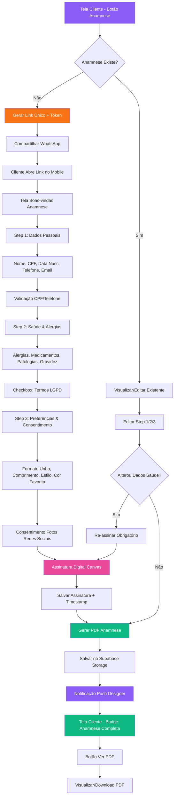

# Fluxo de Anamnese

Link WhatsApp → 3 steps → PDF assinado → Notificação

## Legendas

### Estados
| Código | Descrição |
|--------|-----------|
| `PENDENTE` | Link gerado, aguardando cliente preencher |
| `EM_PREENCHIMENTO` | Cliente acessou, preenchendo steps |
| `ASSINADO` | Assinatura digital capturada + timestamp |
| `CONCLUÍDA` | PDF gerado, salvo, designer notificado |

### Decisões
| Nó | Pergunta | Sim | Não |
|----|----------|-----|-----|
| B | Anamnese Existe? | Visualizar/Editar | Gerar Link Novo |
| J | Validação CPF/Telefone | Próximo Step | Erro + Retentar |
| Z | Alterou Dados Saúde? | Re-assinar Obrigatório | Gerar PDF Direto |

### Steps (3 etapas obrigatórias)
1. **Dados Pessoais**: Nome, CPF, data nasc, telefone, email + validação
2. **Saúde & Alergias**: Alergias, medicamentos, patologias, gravidez + LGPD checkbox
3. **Preferências & Consentimento**: Formato/comprimento/estilo/cor + consentimento fotos

### Ações Principais
- **Link Único + Token**: Expiração 7 dias, uso único
- **Assinatura Digital**: Canvas touch, salva timestamp + IP
- **PDF**: Gera com todos os 3 steps + assinatura + metadados
- **Notificação Designer**: Push in-app + badge no cliente