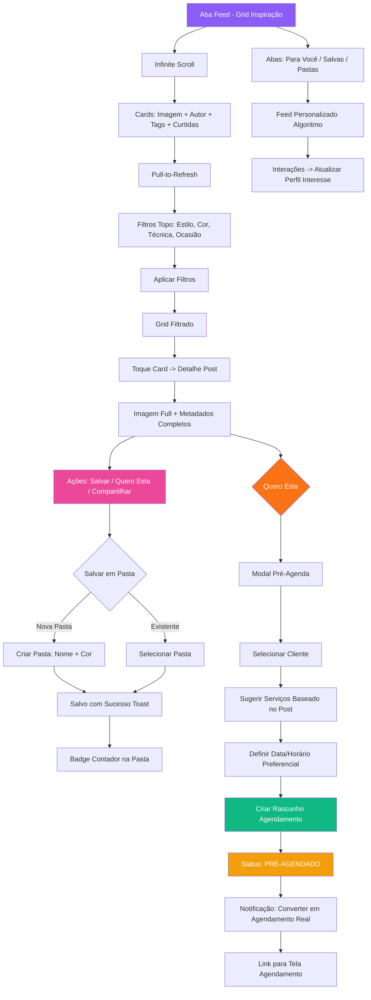

# Fluxo de Feed

Scroll → Salvar pasta → 'Quero esta' → Pré-agenda

## Legendas

### Estados
| Código | Descrição |
|--------|-----------|
| `PRÉ-AGENDADO` | Rascunho criado a partir de inspiração, aguarda confirmação |
| `SALVO` | Post salvo em pasta pessoal da designer |

### Abas do Feed
| Aba | Fonte |
|-----|-------|
| `Para Você` | Algoritmo baseado em interações (curtidas, salvos, 'quero esta') |
| `Salvas` | Posts salvos pela designer (flat list) |
| `Pastas` | Organização hierárquica por pastas criadas |

### Decisões
| Nó | Pergunta | Opções |
|----|----------|--------|
| K | Salvar em Pasta? | Nova Pasta (nome+cor) / Existente (select) |
| P | Quero Esta? | Abre Modal Pré-Agenda / Não faz nada |

### Ações Principais
- **Infinite Scroll + Pull-to-Refresh**: Paginação automática + atualização manual
- **Filtros**: Estilo, Cor, Técnica, Ocasião (chips no topo)
- **Salvar**: Organiza em pastas coloridas com badge contador
- **'Quero Esta'**: Fluxo direto para pré-agenda → seleciona cliente → sugere serviços baseados nas tags do post → define data/horário → cria rascunho `PRÉ-AGENDADO`
- **Notificação Conversão**: Push para transformar pré-agenda em agendamento real (link direto)
- **Algoritmo**: Interações (curtir, salvar, quero esta) atualizam perfil de interesse → feed personalizado