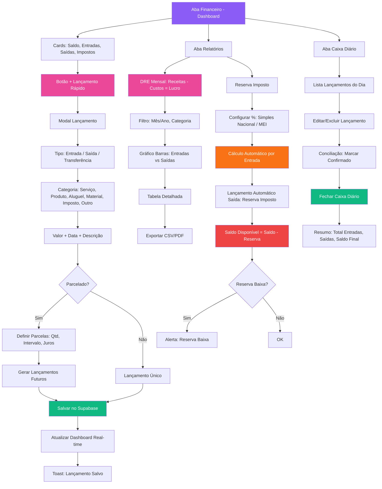

# Fluxo Financeiro

Lançamento rápido → Parcelado → DRE → Reserva imposto

## Legendas

### Estados
| Código | Descrição |
|--------|-----------|
| `PENDENTE` | Lançamento criado, aguardando conciliação |
| `CONFIRMADO` | Marcar confirmado no caixa diário |
| `PARCELADO` | Lançamento pai + filhos futuros gerados |
| `RESERVA_IMPOSTO` | Saída automática calculada sobre entradas |

### Categorias
| Tipo | Categorias |
|------|------------|
| **Entrada** | `SERVIÇO`, `PRODUTO`, `OUTRO` |
| **Saída** | `ALUGUEL`, `MATERIAL`, `IMPOSTO`, `OUTRO` |
| **Transferência** | Entre contas/caixas da designer |

### Regimes de Imposto (configuração Reserva)
| Regime | % Padrão | Base Cálculo |
|--------|----------|--------------|
| `MEI` | Fixo mensal (DAS) | Não automático |
| `SIMPLES_NACIONAL` | 6% - 19% (anexo) | Sobre receita bruta mensal |
| `LUCRO_PRESUMIDO` | ~13.33% + 3.65% | Sobre receita bruta |
| `LUCRO_REAL` | Variável | Sobre lucro apurado |

### Decisões
| Nó | Pergunta | Sim | Não |
|----|----------|-----|-----|
| H | Parcelado? | Definir qtd/intervalo/juros → Gerar futuros | Lançamento único |
| Z | Reserva Baixa? | Alerta vermelho no dashboard | OK |

### Ações Principais
- **Lançamento Rápido**: Modal simplificado (tipo, categoria, valor, data, descrição)
- **Parcelado**: Gera lançamentos filhos com datas futuras + juros opcional
- **Real-time Dashboard**: Cards atualizam instantaneamente via Supabase Realtime
- **DRE Mensal**: Receitas (serviço+produto) - Custos (fixos+variáveis) = Lucro + export CSV/PDF
- **Reserva Imposto Automática**: % configurado → calcula sobre cada entrada → cria saída `RESERVA_IMPOSTO` → Saldo Disponível = Saldo Total - Reserva
- **Caixa Diário**: Lista do dia + editar/excluir + conciliação (marcar confirmado) + fechar caixa → resumo final