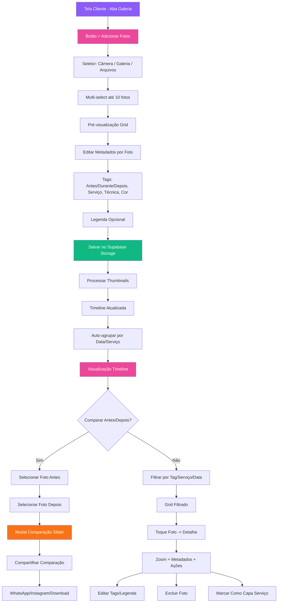

# Fluxo de Galeria

Upload fotos → Tags → Comparação antes/depois

## Legendas

### Estados
| Código | Descrição |
|--------|-----------|
| `UPLOADING` | Fotos selecionadas, processando thumbnails |
| `SALVA` | Foto persistida no Storage + metadados |
| `CAPA_SERVICO` | Foto marcada como representação do serviço |

### Tags Obrigatórias (pelo menos uma)
| Categoria | Valores |
|-----------|---------|
| **Momento** | `ANTES`, `DURANTE`, `DEPOIS` |
| **Serviço** | Lista dinâmica dos serviços da designer |
| **Técnica** | `GEL`, `ACRYLIC`, `FIBRA`, `ESMALTE`, `NAIL_ART`, `OUTRO` |
| **Cor** | Paleta pré-definida + personalizada |

### Decisões
| Nó | Pergunta | Sim | Não |
|----|----------|-----|-----|
| N | Comparar Antes/Depois? | Modal Slider | Filtros Normais |

### Ações Principais
- **Multi-select**: Até 10 fotos por upload (câmera/galeria/arquivos)
- **Metadados por foto**: Tags obrigatórias (momento + serviço) + opcionais (técnica, cor, legenda)
- **Auto-agrupamento**: Timeline por data + agrupamento por serviço
- **Comparação Slider**: Duas fotos (ANTES + DEPOIS) → slider interativo → share WhatsApp/Instagram/Download
- **Capa do Serviço**: Marca foto como thumbnail do serviço na lista