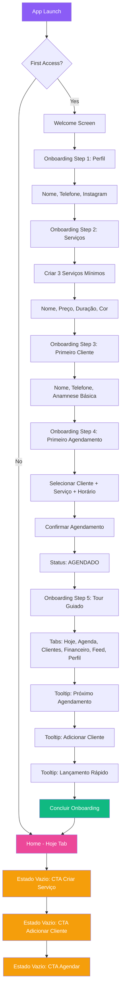

# Fluxo de Onboarding

Primeiro acesso → 3 serviços + 1 cliente + 1 agendamento

## Legendas

### Estados
| Código | Descrição |
|--------|-----------|
| `AGENDADO` | Agendamento criado, aguardando confirmação do cliente |

### Decisões
| Nó | Pergunta | Sim | Não |
|----|----------|-----|-----|
| B | First Access? | Welcome Screen | Home - Hoje Tab |

### Ações Principais
- **Criar 3 Serviços Mínimos**: Nome, preço, duração, cor por serviço
- **Primeiro Cliente**: Nome, telefone, anamnese básica
- **Primeiro Agendamento**: Selecionar cliente + serviço + horário → Status AGENDADO
- **Tour Guiado**: 3 tooltips sequenciais nas tabs principais